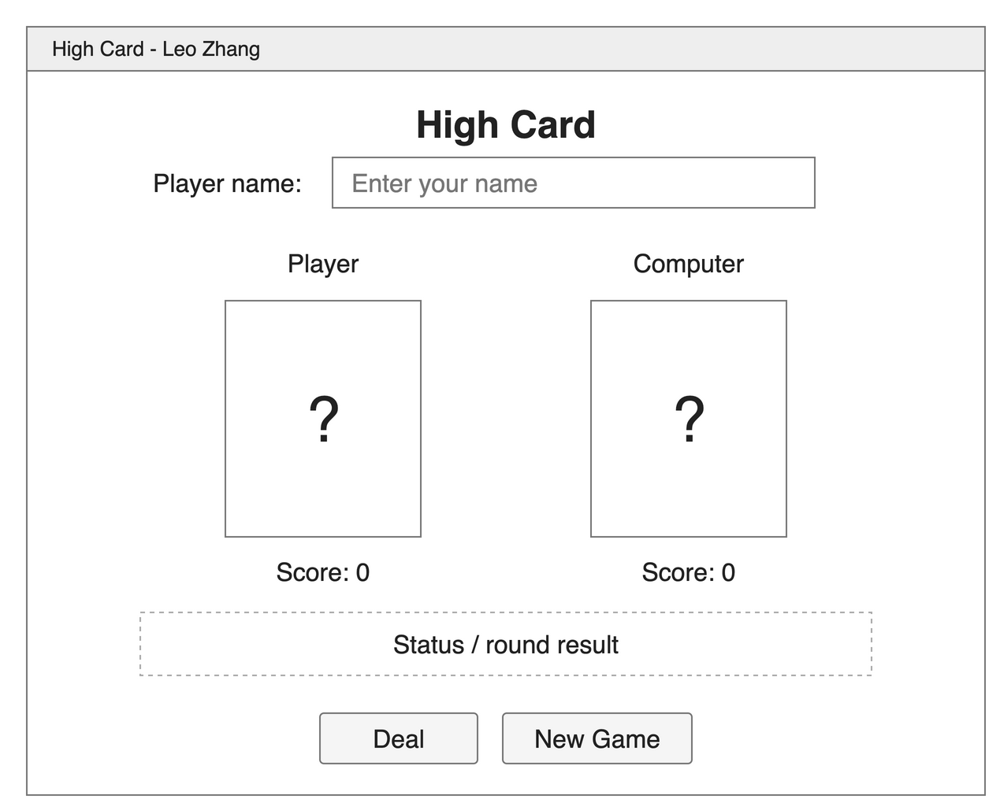

# High Card - Unit Deliverable 2

I am building a simple JavaFX card game based on the Card class from UD0 and my Player model from UD1. In the planned game, the player and computer each draw a card, and the higher card earns one point. The interface shows both cards and scores, with Deal and New Game buttons.

## GUI Wireframe

## UD2 Implementation

New Game reads the name field, creates Player objects for the player and computer, and displays their names and starting scores. Invalid constructor input throws IllegalArgumentException, following the UD1 feedback; the interface displays the error message. Deal has an event handler that updates the status and prints a message to the console. The card areas are placeholders; dealing and scoring will be completed in UD3.

## Run

Open this project in IntelliJ IDEA with JDK 23 and load the Maven project. In the Maven tool window, execute `clean compile javafx:run` to launch HelloApplication.
